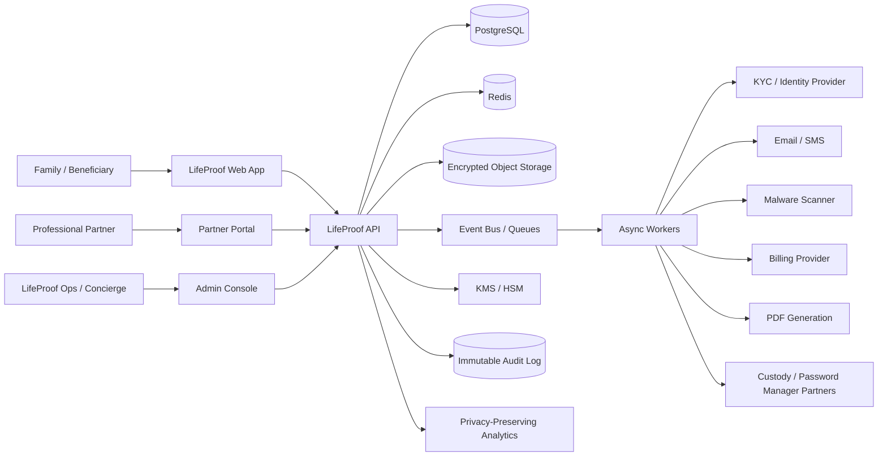
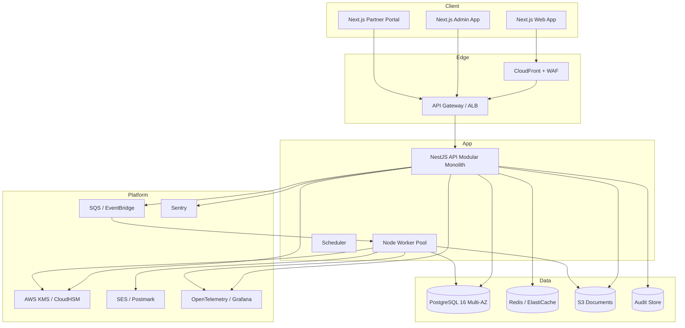
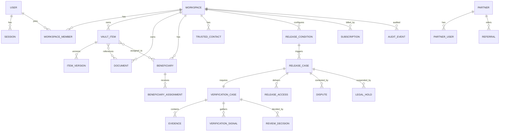
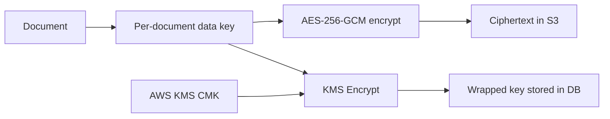
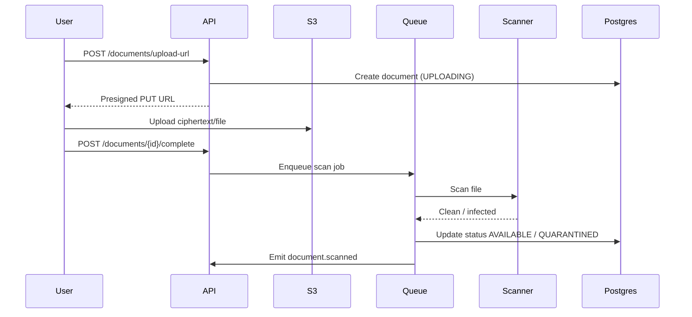
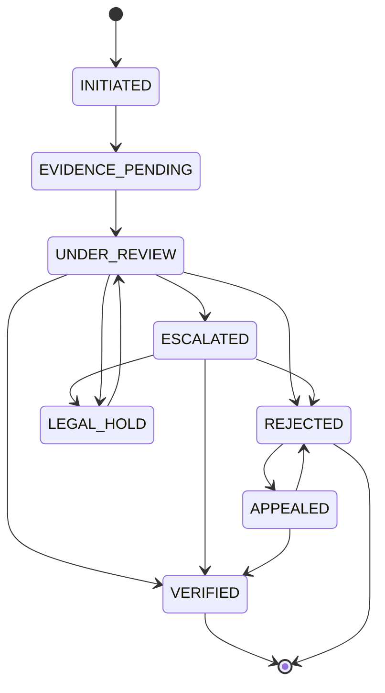
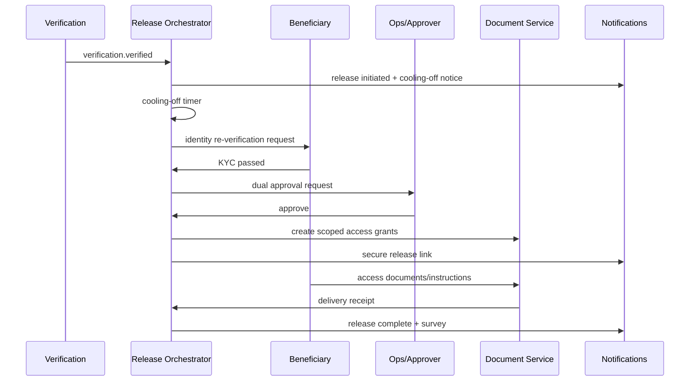

# LifeProof Continuity Platform — Technical Architecture & Security Design v1.0

**Status:** Build-ready draft
**Date:** 5 November 2026
**Audience:** Engineering, security, DevOps, data, QA
**Companion documents:** [`01_PRD.md`](./01_PRD.md), [`00_STRATEGY_KERNEL.md`](./00_STRATEGY_KERNEL.md)

---

## 1. Architecture principles

1. **Control plane, not data plane.** LifeProof stores metadata, instructions, documents, and verification evidence — never crypto seed phrases or private keys.
2. **API-first.** Every capability is a versioned domain service that can later be exposed to partners.
3. **Modular monolith first.** Ship fast with strong domain boundaries; split services only when scale or security requires it.
4. **Event-driven where it matters.** Verification, release, notifications, scanning, billing, and webhooks use asynchronous jobs with an outbox.
5. **Zero trust and least privilege.** Every request is authenticated, authorized, scoped to a tenant, and audited.
6. **Defense in depth.** RLS, RBAC, encryption, signed URLs, MFA, four-eyes, audit, and monitoring are layered.
7. **No custom cryptography.** Use proven primitives and managed key services.
8. **Continuity by design.** Exportable data, open recovery format, source escrow, and documented runbooks.

---

## 2. System context



### Actors

| Actor | Trust level | Primary interface |
|---|---|---|
| Family member | Authenticated customer | Web app |
| Beneficiary | Authenticated, identity-verified | Beneficiary portal |
| Trusted contact | Authenticated, invited | Web app / email |
| Professional partner | Authenticated partner tenant | Partner portal / API |
| Ops/concierge | Internal, hardware-key MFA | Admin console |
| Super admin | Internal, dual control | Admin console |
| Partner system | Machine, OAuth2 scopes | Partner API |
| Regulator/court | Out-of-band | Evidence export |

---

## 3. Container architecture



---

## 4. Recommended technology stack

| Layer | Choice | Rationale |
|---|---|---|
| Web app | Next.js 15 (App Router), React 19, TypeScript | SSR, performance, ecosystem, responsive web |
| UI | Tailwind CSS, shadcn/ui, Radix primitives | Accessible, consistent, fast to build |
| Forms/validation | React Hook Form + Zod | Shared schemas with API |
| Data fetching | TanStack Query | Caching, retries, optimistic updates |
| Admin app | Next.js on a separate admin domain | Isolation, SSO, hardware-key access |
| API | NestJS (TypeScript) modular monolith | Strong module boundaries, DI, OpenAPI integration |
| ORM/migrations | Drizzle ORM + SQL migrations | Type-safe, transparent SQL, good Postgres support |
| Database | PostgreSQL 16, Multi-AZ, RLS | ACID, JSONB, full-text search, row-level security |
| Cache/queues | Redis (ElastiCache) + BullMQ | Rate limits, sessions, jobs |
| Event bus | AWS EventBridge / SQS | Durable async, retries, DLQ |
| Object storage | S3 with SSE-KMS, versioning, Object Lock | Durable encrypted document storage |
| Key management | AWS KMS (MVP), CloudHSM (Phase 2) | Managed, audited, FIPS 140-2 |
| Auth | Managed auth provider (Clerk/Stytch/WorkOS) behind an abstraction | Passkeys, TOTP, enterprise SSO without custom crypto |
| Payments | Stripe (MVP), Paystack/Flutterwave (Phase 2) | Global + local |
| KYC | Smile ID (Africa), Onfido/Jumio (UK) | Document + liveness + sanctions |
| Email/SMS | Postmark/SES + Twilio/Termii | Deliverability, local reach |
| Analytics | PostHog self-hosted or Plausible | Privacy-preserving product analytics |
| Error tracking | Sentry | Release health, alerts |
| Feature flags | Unleash/Flagsmith self-hosted | Kill switches, gradual rollout |
| PDF generation | Playwright service | Emergency packs, receipts |
| Search | Postgres full-text + trigram | Metadata search; no content indexing |
| IaC | Terraform | Reproducible infrastructure |
| CI/CD | GitHub Actions | Standard, auditable |
| Observability | OpenTelemetry + Grafana stack (Tempo/Loki/Mimir) | Traces, logs, metrics, SLOs |
| Docs | OpenAPI 3.1 + Redoc | Partner and internal contracts |

**Alternatives considered:** microservices from day one (rejected: too slow), Django/Python (viable, but TypeScript shares schemas and reduces context switching), Kubernetes (rejected for MVP: ECS Fargate is simpler), custom auth (rejected: security risk).

---

## 5. Domain modules

| Module | Responsibilities | Key dependencies |
|---|---|---|
| `identity` | Users, credentials, sessions, MFA, passkeys, recovery | Auth provider, Redis |
| `workspaces` | Workspaces, members, roles, plans, entitlements | Billing |
| `vault` | Categories, items, versions, sealing, readiness | Documents, conditions |
| `documents` | Upload, scan, encrypt, store, version, access | S3, KMS, scanner |
| `relationships` | Beneficiaries, trusted contacts, professionals, guardians | Identity, notifications |
| `conditions` | Trigger types, per-item rules, cooling-off | Vault |
| `verification` | Cases, evidence, signals, KYC, review, legal hold | KYC, documents, audit |
| `release` | Release cases, approvals, identity re-verification, delivery, receipts | Verification, documents, notifications |
| `notifications` | Email, in-app, SMS alerts, partner webhooks | SES/SMS, preferences |
| `billing` | Plans, subscriptions, invoices, seats, coupons | Stripe/Paystack |
| `admin` | Ops console, queues, dual control, support | All domains |
| `audit` | Immutable events, hash chain, export | All domains |
| `analytics` | Product events, dashboards | Analytics provider |
| `partners` (P1) | Tenants, white-label, API keys, webhooks, revenue share | All domains |
| `crypto` (P1) | Custody partner adapters, crypto inventory, attestations | Partner APIs |
| `business` (P2) | Business workspaces, roles, key-person release | Workspaces, release |
| `integrations` | KYC, payments, email, storage, password managers, custody | Third parties |

### Module boundaries

- Modules communicate through **application services** and **domain events**, not direct table access.
- Cross-module reads use explicit query services.
- No shared mutable state; no distributed transactions. Use the **outbox pattern** for events.
- Each module owns its tables and migrations.

---

## 6. Data architecture

### 6.1 Tenancy model

- Shared PostgreSQL schema with `workspace_id` on every tenant-owned table.
- **Row-Level Security (RLS)** enforced at the database layer.
- Application sets `app.current_workspace_id` and `app.current_user_id` per transaction.
- Partner tenants use `partner_id` scoping; partner users can only access consented client workspaces.
- Super-admin access is a separate role with reason logging and never bypasses RLS without an explicit, audited elevation.

### 6.2 Entity relationship diagram (core)



### 6.3 Core tables (abridged)

| Table | Key columns | Notes |
|---|---|---|
| `users` | `id`, `email_ciphertext`, `email_hash`, `name`, `locale`, `status`, `created_at` | Email encrypted + deterministic hash for lookup |
| `sessions` | `id`, `user_id`, `device_id`, `ip_hash`, `expires_at`, `revoked_at` | IP hashed for privacy |
| `workspaces` | `id`, `type`, `name`, `plan_id`, `region`, `status` | `type`: personal/family/business |
| `workspace_members` | `workspace_id`, `user_id`, `role`, `status` | Unique per workspace |
| `vault_items` | `id`, `workspace_id`, `category`, `type`, `title`, `status`, `condition_id`, `sealed_at` | `status` state machine |
| `item_versions` | `id`, `item_id`, `version`, `changed_by`, `diff_hash` | Append-only |
| `documents` | `id`, `workspace_id`, `storage_key`, `sha256`, `mime`, `size`, `scan_status`, `key_ref`, `status` | Encrypted metadata |
| `document_versions` | `id`, `document_id`, `version`, `storage_key`, `sha256` | Retention policy |
| `beneficiaries` | `id`, `workspace_id`, `name_ciphertext`, `email_ciphertext`, `relationship`, `kyc_status`, `status` | PII encrypted |
| `beneficiary_assignments` | `beneficiary_id`, `item_id`, `share`, `condition_id` | Shares validated |
| `trusted_contacts` | `id`, `workspace_id`, `user_id`, `role`, `consent_status`, `verified_at` | Roles: verifier/executor/guardian/professional |
| `release_conditions` | `id`, `workspace_id`, `item_id`, `type`, `cooling_off_days`, `verifier_ids` | JSONB rules |
| `verification_cases` | `id`, `workspace_id`, `condition_id`, `type`, `status`, `assignee_id`, `decision`, `sla_due_at` | State machine |
| `verification_signals` | `id`, `case_id`, `type`, `source`, `confidence`, `status`, `payload_hash` | No raw PII in payload |
| `evidence` | `id`, `case_id`, `document_id`, `type`, `redaction_status` | Encrypted docs |
| `review_decisions` | `id`, `case_id`, `reviewer_id`, `outcome`, `rationale`, `created_at` | Four-eyes |
| `release_cases` | `id`, `verification_case_id`, `status`, `cooling_off_end`, `approver_ids` | State machine |
| `release_access` | `id`, `release_case_id`, `beneficiary_id`, `item_ids`, `expires_at` | Time-bound |
| `release_receipts` | `id`, `release_case_id`, `delivered_items`, `acknowledged_at`, `hash` | Proof |
| `legal_holds` | `id`, `release_case_id`, `reason`, `court_ref`, `applied_by`, `status` | Suspends release |
| `disputes` | `id`, `release_case_id`, `claimant_id`, `status`, `resolution` | Appeal path |
| `audit_events` | `id`, `actor_id`, `action`, `subject_type`, `subject_id`, `before_hash`, `after_hash`, `ip_hash`, `created_at`, `prev_hash`, `hash` | Append-only, hash chain |
| `consents` | `id`, `user_id`, `purpose`, `version`, `granted_at`, `withdrawn_at` | Versioned |
| `partners` | `id`, `name`, `type`, `status`, `branding`, `revenue_share` | P1 |
| `api_keys` | `id`, `partner_id`, `scopes`, `hash`, `expires_at` | P1 |
| `webhooks` | `id`, `partner_id`, `url`, `secret_ciphertext`, `events`, `status` | P1 |
| `emergency_packs` | `id`, `workspace_id`, `version`, `storage_key`, `pin_hash`, `status` | PIN never recoverable |
| `rehearsals` | `id`, `workspace_id`, `status`, `report_json` | P1 |
| `outbox_events` | `id`, `aggregate_type`, `aggregate_id`, `event_type`, `payload`, `status`, `attempts` | Reliable events |

### 6.4 Data classification

| Class | Examples | Storage | Retention |
|---|---|---|---|
| Secret | Seed phrases, private keys, passwords | **Never stored** (except optional low-risk encrypted note P1) | N/A |
| Sensitive PII | Beneficiary names, emails, phone, ID evidence | Encrypted fields + RLS | Plan lifetime + 30 days after deletion request |
| Confidential documents | Wills, insurance, IDs, PoA | S3 SSE-KMS, signed URLs | Plan lifetime + grace |
| Case evidence | Death certificates, PoA, medical evidence | S3 SSE-KMS, restricted access | 7 years or legal requirement |
| Audit | Access/decision events | Append-only, hash-chained | 7 years |
| Analytics | Product events, no PII | Analytics store | 24 months |

### 6.5 Retention and deletion

- Soft delete with 30-day recovery window for user-facing items.
- Hard delete jobs purge S3 objects, versions, and derived data.
- Legal-hold records override deletion with documented justification.
- Audit events are retained even after account deletion, with PII minimized.
- Backups expire per policy; deletion propagates within 30 days.

---

## 7. Identity and access

### 7.1 Authentication

- Managed auth provider for passkeys/WebAuthn, TOTP, email verification, and session management.
- LifeProof owns the user record and maps provider identities to internal users.
- Step-up authentication required for: sealing, changing beneficiaries, downloading emergency pack, admin actions, release approval.
- Recovery: recovery kit (one-time codes) + email + admin-assisted identity verification. **No SMS OTP.**
- Session: short-lived access token + rotating refresh; device binding; revoke-all.

### 7.2 Authorization

- RBAC with workspace scoping:
  - `owner`, `admin`, `member`, `family_organiser`, `beneficiary`, `professional`, `support`, `super_admin`.
- Permission matrix (abridged):

| Permission | Owner | Admin | Member | Family Organiser | Beneficiary | Professional | Support | Super Admin |
|---|---|---|---|---|---|---|---|---|
| Manage billing | ✅ | ✅ | — | — | — | — | — | ✅ |
| Invite members | ✅ | ✅ | — | ✅ (setup only) | — | — | — | ✅ |
| Create/edit items | ✅ | ✅ | ✅ | ✅ (assigned) | — | — | — | — |
| View sealed contents | ✅ | ✅ | ✅ | — | — | — | — | — |
| View beneficiary summary | ✅ | ✅ | ✅ | ✅ | ✅ (own) | ✅ (consented) | — | ✅ |
| Configure conditions | ✅ | ✅ | — | — | — | — | — | — |
| Approve release | — | — | — | — | — | — | — | ✅ (dual) |
| View audit | ✅ | ✅ | — | — | — | — | — | ✅ |
| Place legal hold | — | — | — | — | — | — | — | ✅ (legal) |

- ABAC rules for partner scope, consent, and legal hold.
- Postgres RLS as defense in depth.
- Admin actions require `reason_for_access`; sensitive actions require four-eyes.

### 7.3 Session and device security

- Device fingerprint hash, IP hash, user agent.
- New-device notification.
- Concurrent session limit; revoke individual/all.
- Idle timeout: 30 minutes (web), 8 hours (remembered device, with re-auth for sensitive actions).
- Admin sessions: 15-minute idle timeout; hardware key required.

---

## 8. Encryption and key management

### 8.1 MVP model (KMS envelope encryption)



- Each document gets a random 256-bit data key.
- Document encrypted with AES-256-GCM; ciphertext + nonce + auth tag stored in S3.
- Data key wrapped by KMS CMK; wrapped key stored with document metadata.
- KMS grants restricted to the document service role; all decrypt calls logged.
- Key rotation: annual CMK rotation; re-wrap data keys without re-encrypting documents.
- Database field encryption for sensitive PII (beneficiary contact, evidence metadata) using KMS-derived keys.

**Why this for MVP:** simple, auditable, low operational risk. It does not provide zero-knowledge against a compromised server, so the security claims must be precise: “encrypted at rest with HSM-backed keys and strict access controls,” not “zero-knowledge.”

### 8.2 Phase 2 high-security tier (client-side encryption)

- User master key derived from passphrase + device key using Argon2id.
- Per-document keys wrapped by master key; client encrypts before upload.
- Recovery via Shamir shards held by user, trusted contact, and Continuity Trust/escrow.
- Server stores ciphertext + wrapped keys only.
- Release requires beneficiary shard + trusted contact shard + identity verification.
- Open-source recovery client and documented format.

### 8.3 Key management controls

- KMS/CloudHSM access via IAM roles; no long-lived keys.
- Dual control for key deletion/rotation.
- Key ceremony documented and witnessed before launch.
- Break-glass procedure with two approvers and audit.
- No custom crypto; libraries: Web Crypto API, Node `crypto`, libsodium where appropriate.
- Secrets in AWS Secrets Manager; no secrets in env files or code.

---

## 9. Document pipeline



### Controls

- Presigned URL TTL 15 minutes; content-type and size enforced.
- Server-side encryption with KMS; bucket policy denies unencrypted PUT.
- Malware scan before `AVAILABLE`; quarantine bucket for infected files.
- MIME sniffing and extension validation; reject executables/archives unless explicitly allowed.
- SHA-256 stored; verified on download.
- Signed download URL TTL 5 minutes; one-time token for release sessions.
- No content indexing; metadata search only.
- Watermark for preview; download audit event.
- Per-document access log with actor, IP hash, timestamp.

---

## 10. Verification engine

### 10.1 Case lifecycle



### 10.2 Signals and scoring

| Signal | Source | Weight (MVP) | Notes |
|---|---|---|---|
| Certified death certificate | Claimant upload | High | Verify issuer, date, subject match |
| Claimant identity | KYC provider | High | Document + liveness + sanctions/PEP |
| Beneficiary identity | KYC provider | High | Re-verified at release |
| Trusted contact attestation | Invited contact | Medium | Minimum two independent contacts |
| Professional attestation | Solicitor/doctor/employer | High | Verified against registry |
| Relationship/probate evidence | Upload | Medium | Will, grant of probate |
| Registry match | Government/partner | High | Phase 3 |
| Fraud/velocity checks | Internal | Risk flag | Duplicate claims, device/IP anomalies |
| Sanctions/PEP | KYC provider | Risk flag | Escalate if hit |

**Decision rule for MVP:** no automated release. Ops reviews all signals; high-risk or ambiguous cases escalate to legal. A confidence score is advisory only.

### 10.3 Evidence handling

- Evidence stored as encrypted documents, restricted to case assignee + legal reviewer.
- Redaction supported before storage (Phase 2).
- Evidence access logged with reason.
- Retention: 7 years or legal requirement; purge after case closure + retention.
- No evidence in email; secure upload links only.

### 10.4 Legal hold and disputes

- Legal hold is a first-class state; it blocks release and notifies stakeholders.
- Dispute creates a legal hold automatically; release cannot proceed until resolved.
- Every action is audited with actor, reason, timestamp, and evidence reference.
- Court orders stored as evidence with reference number.

---

## 11. Release orchestration

### 11.1 Release saga



### 11.2 Controls

- Idempotent steps; each step has a unique key.
- Cooling-off timer persisted; no in-memory timers.
- Dual approval for all releases (two ops/legal users).
- Beneficiary identity re-verification immediately before access.
- Scoped access grants with 5–30 minute expiry; no permanent links.
- Partial release supported by item/beneficiary.
- Legal hold can interrupt any step before delivery.
- Delivery receipt with hash of delivered manifest.
- Post-release access expires; re-access requires support.
- Full audit trail.

### 11.3 Failure handling

- Retry with exponential backoff for transient failures.
- Dead-letter queue for notifications/webhooks.
- Compensation: revoke grants, notify ops, create incident.
- If delivery partially fails, record delivered items and retry remaining; never re-deliver to wrong beneficiary.
- Manual override only with dual control and incident record.

---

## 12. API design

### 12.1 Standards

- OpenAPI 3.1 contract-first; generated clients.
- JSON; UTF-8; ISO 8601 timestamps; ISO 4217 currencies.
- `Authorization: Bearer` for API; secure HttpOnly cookies for web sessions.
- `Idempotency-Key` required for POST/PATCH; stored 24 hours.
- `X-Request-Id` returned and logged.
- Cursor pagination: `?cursor=...&limit=...`.
- Errors:

```json
{
  "error": {
    "code": "verification.evidence_required",
    "message": "Additional evidence is required.",
    "details": [{"field": "death_certificate", "reason": "unreadable"}],
    "request_id": "req_..."
  }
}
```

### 12.2 Versioning and deprecation

- `/v1` base path; additive changes preferred.
- Breaking changes require `/v2` and 6-month deprecation notice.
- Deprecation headers: `Sunset`, `Deprecation`, `Link`.
- Partner API changelog and status page.

### 12.3 Rate limits

| Tier | Limit |
|---|---|
| Web user | 120 req/min |
| Partner API | 600 req/min (configurable) |
| Auth endpoints | 10 req/min per IP/account |
| Upload initiation | 30/hour |
| Verification submission | 10/hour |

### 12.4 Webhooks (Phase 2)

- HMAC-SHA256 signature in `X-LifeProof-Signature`.
- Timestamp + replay protection.
- Retries: 5 attempts with exponential backoff; DLQ after.
- Events: `workspace.created`, `plan.sealed`, `verification.initiated`, `verification.evidence_required`, `verification.verified`, `verification.rejected`, `release.cooling_off`, `release.ready`, `release.completed`, `release.disputed`, `document.scanned`, `subscription.updated`.
- Partner endpoint must return 2xx within 10 seconds.

---

## 13. Multi-tenancy, RBAC, and data isolation

- `workspace_id` on all tenant tables; RLS policy `workspace_id = current_setting('app.workspace_id')::uuid`.
- Partner access requires an explicit `partner_workspace_grants` row with consent and scope.
- Admin access uses a separate role and `admin_access_grants` with reason and expiry.
- No cross-tenant joins in application queries; reporting uses a separate read model.
- Tenant-aware caching keys; no shared cache entries.
- S3 prefixes per workspace; IAM conditions enforce prefix access.
- Audit events include tenant and actor.

---

## 14. Infrastructure and environments

### 14.1 AWS topology

| Component | Service | Notes |
|---|---|---|
| CDN/WAF | CloudFront + AWS WAF | DDoS, bot, geo rules |
| API | ECS Fargate behind ALB | Autoscaling, blue/green |
| Workers | ECS Fargate service | Queue-driven autoscaling |
| Scheduler | EventBridge Scheduler | Reminders, SLA timers |
| Database | RDS PostgreSQL Multi-AZ | PITR, encryption, RLS |
| Cache | ElastiCache Redis | Sessions, rate limits, locks |
| Storage | S3 + KMS | Versioning, Object Lock for audit |
| Queue | SQS + EventBridge | DLQ, retries |
| Secrets | Secrets Manager | Rotation |
| Keys | KMS (MVP), CloudHSM (P2) | FIPS 140-2 |
| Email | SES/Postmark | DKIM/SPF/DMARC |
| Observability | OpenTelemetry + Grafana Cloud | Traces/logs/metrics |
| Errors | Sentry | Release health |
| Status | Statuspage/instatus | Public comms |

### 14.2 Environments

| Environment | Purpose | Data | Access |
|---|---|---|---|
| `dev` | Feature development | Synthetic | Engineers |
| `staging` | Integration/UAT | Synthetic/anonymized | Engineers, QA, product |
| `prod` | Live | Real | Break-glass only |
| `preview` | Per-PR ephemeral | Synthetic | Engineers |

- Separate AWS accounts for prod and non-prod (recommended).
- No production data in non-prod; anonymization pipeline if needed.
- Infrastructure as code; no console changes in prod.
- Secrets never in code; pre-commit hooks and CI scanning.

### 14.3 CI/CD

**Pipeline stages:**
1. Lint, format, typecheck.
2. Unit tests.
3. Build.
4. SAST (CodeQL), SCA (Snyk/Dependabot), secret scanning (Gitleaks).
5. Container/image scan (Trivy).
6. IaC scan (Checkov/tfsec).
7. Integration tests (Postgres/Redis via Testcontainers).
8. E2E tests (Playwright) on preview.
9. Migration check (expand/contract).
10. Deploy to staging; smoke tests.
11. Manual approval; canary/blue-green to prod.
12. Post-deploy smoke + synthetic checks.

**Rules:**
- Required reviews; CODEOWNERS for security-critical paths.
- Signed commits; branch protection.
- Migrations backward-compatible for one release.
- Feature flags for risky changes.
- Rollback runbook; database rollback strategy (forward-fix preferred).

### 14.4 Testing strategy

| Layer | Tool | Coverage |
|---|---|---|
| Unit | Vitest/Jest | Domain logic, policies, validators |
| Integration | Testcontainers + Supertest | API + DB + RLS |
| Contract | OpenAPI schema tests | API compatibility |
| E2E | Playwright | Critical journeys |
| Security | ZAP, CodeQL, Snyk | OWASP Top 10 |
| Performance | k6 | Target load |
| Accessibility | axe + manual | WCAG 2.2 AA |
| DR | Game day | Restore, failover |
| Pen test | External firm | Pre-launch and annual |

---

## 15. Observability

- **Logs:** structured JSON, request ID, workspace ID, actor ID, no PII/content.
- **Metrics:** golden signals (latency, traffic, errors, saturation); business metrics (seals, invitations, verification cases, releases).
- **Traces:** OpenTelemetry across API, workers, DB, S3.
- **SLOs:** availability 99.9%; API p95 < 300ms; release delivery < 2s; verification SLA.
- **Alerts:** error budget burn, queue depth, DLQ, failed scans, release stuck > 1h, legal hold, auth anomalies.
- **Dashboards:** ops, security, billing, partner.
- **Audit:** separate from observability; immutable and access-controlled.

---

## 16. Security threat model and controls

### 16.1 STRIDE summary

| Threat | Example | Controls |
|---|---|---|
| **Spoofing** | Credential stuffing, phishing | Passkeys, TOTP, rate limits, device binding, notifications |
| **Tampering** | Modify evidence/release scope | Hash chain, immutable audit, four-eyes, signed manifests |
| **Repudiation** | Deny approving release | Audit with actor, timestamp, reason, signature |
| **Information disclosure** | Document leak, admin overreach | Encryption, RLS, least privilege, no bulk download, watermarks |
| **Denial of service** | Upload flood, auth flood | WAF, rate limits, quotas, queue backpressure |
| **Elevation of privilege** | Support role escalates | RBAC, four-eyes, JIT access, access reviews |
| **Supply chain** | Malicious dependency | SCA, lockfiles, signed builds, vendor review |
| **Insider** | Ops views documents | Reason logging, session recording, separation of duties |
| **Legal compulsion** | Subpoena | Minimization, legal review, transparency report |
| **Platform failure** | Company shutdown | Continuity Trust, open recovery, export |

### 16.2 Security controls checklist

- [ ] Threat model reviewed per release
- [ ] SAST/DAST/SCA in CI
- [ ] Dependency and container scanning
- [ ] Secret scanning and rotation
- [ ] Pen test pre-launch and annually
- [ ] Bug bounty/disclosure policy
- [ ] Incident response plan and tabletop
- [ ] Access reviews quarterly
- [ ] Admin hardware keys + SSO
- [ ] Encryption/key ceremony
- [ ] Backup/restore test
- [ ] DR game day
- [ ] Vendor security review
- [ ] DPA/subprocessor register
- [ ] Privacy impact assessment
- [ ] Logging/alerting for anomalies

### 16.3 Incident response

1. **Detect:** alert, report, or monitoring.
2. **Triage:** severity (SEV1–SEV4), incident commander.
3. **Contain:** revoke sessions/keys, freeze releases, isolate services.
4. **Eradicate:** patch, rotate credentials, remove access.
5. **Recover:** restore service, verify integrity, monitor.
6. **Notify:** legal/regulator/customers per policy (72-hour GDPR path).
7. **Review:** blameless postmortem, action items, audit.

---

## 17. Disaster recovery and business continuity

| Scenario | Impact | Response |
|---|---|---|
| AZ failure | Brief degradation | Multi-AZ failover |
| Region failure | Outage | Cross-region backups; restore runbook; RTO 4h |
| Database corruption | Data loss risk | PITR restore; verify audit chain |
| S3 object loss | Document loss | Versioning + cross-region replication |
| Key compromise | Critical | Rotate CMK, re-wrap keys, incident response |
| Ransomware | Critical | Immutable backups, isolated restore |
| Company shutdown | Existential | Continuity Trust, open recovery client, export, source escrow |
| Vendor outage (KYC/email) | Delayed operations | Manual fallback, queue, status page |

**Backups:** RDS automated backups + PITR 35 days; monthly snapshots 12 months; S3 versioning + replication; audit anchors in Object Lock.

**DR tests:** quarterly restore test; annual full failover game day; documented results.

---

## 18. Integrations

| Integration | Pattern | Failure handling |
|---|---|---|
| KYC provider | Synchronous + webhook | Retry, manual review fallback |
| Email/SMS | Queue | Retry, DLQ, suppression list |
| Stripe/Paystack | Webhook + idempotency | Reconcile daily |
| S3 | SDK | Retry, checksum |
| Malware scanner | Queue | Quarantine on failure |
| Password managers (P1) | OAuth/deep link | Informational only |
| Crypto custody (P1) | Partner API/webhook | Manual ops fallback |
| E-signature (P1) | API/webhook | Manual fallback |
| Analytics | Async | No PII; sampling |
| Status page | API | Manual update |

---

## 19. Build vs buy

| Capability | Build | Buy | Recommendation |
|---|---|---|---|
| Auth/passkeys | Complex | Clerk/Stytch/WorkOS | Buy, abstract |
| KYC | Complex/regulated | Smile ID/Onfido/Jumio | Buy |
| Payments | Complex/regulated | Stripe/Paystack | Buy |
| Document storage | Commodity | S3 | Buy |
| Malware scanning | Commodity | ClamAV/managed | Buy/build hybrid |
| PDF generation | Simple | Playwright | Build |
| Verification workflow | Core | — | Build |
| Release orchestration | Core | — | Build |
| Audit ledger | Core | — | Build (hash chain) |
| Crypto custody | High risk | Partners | Partner |
| Password manager | Commodity | 1Password/Bitwarden | Integrate |
| Analytics | Commodity | PostHog/Plausible | Buy/self-host |
| Feature flags | Commodity | Unleash/Flagsmith | Buy/self-host |
| Observability | Commodity | Grafana/Datadog | Buy |

---

## 20. Phase 1 implementation sequence

| Workstream | Weeks | Deliverables | Dependencies |
|---|---|---|---|
| W1 Foundation | 1–3 | Repo, CI/CD, IaC, environments, observability, feature flags | — |
| W2 Identity & workspace | 2–4 | Auth, passkeys, MFA, RBAC, workspace, invites | W1 |
| W3 Vault & documents | 3–6 | Categories, items, sealing, upload, scan, encryption, signed URLs | W1, W2 |
| W4 Relationships & conditions | 5–7 | Beneficiaries, trusted contacts, assignments, triggers, cooling-off | W2, W3 |
| W5 Verification | 6–9 | Cases, evidence, KYC, review queue, decisions, legal hold | W3, W4 |
| W6 Release | 8–10 | Release cases, approvals, identity re-verification, delivery, receipts, disputes | W5 |
| W7 Admin & billing | 8–10 | Ops console, queues, dual control, Stripe, invoices | W2, W5 |
| W8 Trust & launch | 9–10 | Emergency pack, rehearsal (P1), audit, accessibility, pen test, DR | All |

**Team allocation:** 3 full-stack engineers, 1 security engineer, 1 designer, 1 QA, 0.5 DevOps, 1 product, 1 ops/release.

---

## 21. Architecture decision records (ADRs)

| ADR | Decision | Rationale | Consequences |
|---|---|---|---|
| ADR-001 | Modular monolith (NestJS) | Speed, strong boundaries, small team | Extract services when scale demands |
| ADR-002 | PostgreSQL + RLS | Tenant isolation, ACID, JSONB | Must set session variables per transaction |
| ADR-003 | Managed auth provider | Passkeys/MFA without custom crypto | Vendor dependency; abstraction layer |
| ADR-004 | KMS envelope encryption (MVP) | Simple, auditable | Not zero-knowledge; Phase 2 client-side tier |
| ADR-005 | S3 + SSE-KMS | Durable, cost-effective | Egress and lifecycle management |
| ADR-006 | Manual verification/release (MVP) | Prove process before automation | Ops cost; need SLAs |
| ADR-007 | No seed/private-key storage | Reduce honeypot/liability | Crypto continuity via partners only |
| ADR-008 | Outbox + SQS | Reliable events, retries | Operational complexity |
| ADR-009 | API-first OpenAPI | Partner reusability | Contract discipline |
| ADR-010 | Separate admin app/domain | Security isolation | More deployment surface |
| ADR-011 | ECS Fargate over Kubernetes | Simpler ops | Less flexibility |
| ADR-012 | Open-source recovery client (P1) | Continuity/trust | Maintenance burden |

---

## 22. Appendix A — Permission matrix (full)

| Resource/Action | Owner | Admin | Member | Family Organiser | Beneficiary | Professional | Support | Super Admin |
|---|---|---|---|---|---|---|---|---|
| Workspace settings | ✅ | ✅ | — | — | — | — | — | ✅ |
| Billing | ✅ | ✅ | — | — | — | — | — | ✅ |
| Invite member | ✅ | ✅ | — | ✅ (setup) | — | — | — | ✅ |
| Create item | ✅ | ✅ | ✅ | ✅ | — | — | — | — |
| Edit item | ✅ | ✅ | ✅ | ✅ | — | — | — | — |
| View sealed item | ✅ | ✅ | ✅ | — | — | — | — | — |
| Seal/unseal | ✅ | ✅ | ✅ | — | — | — | — | — |
| Upload document | ✅ | ✅ | ✅ | ✅ | — | — | — | — |
| View document | ✅ | ✅ | ✅ | — | — | — | — | ✅ (reason) |
| Manage beneficiaries | ✅ | ✅ | — | ✅ | — | — | — | — |
| Manage trusted contacts | ✅ | ✅ | — | ✅ | — | — | — | — |
| Configure conditions | ✅ | ✅ | — | — | — | — | — | — |
| Initiate claim | ✅ | ✅ | ✅ | ✅ | ✅ | ✅ | — | — |
| Review verification | — | — | — | — | — | — | — | ✅ |
| Approve release | — | — | — | — | — | — | — | ✅ (dual) |
| Place legal hold | — | — | — | — | — | — | — | ✅ (legal) |
| View audit | ✅ | ✅ | — | — | — | — | — | ✅ |
| Export data | ✅ | ✅ | — | — | — | — | — | ✅ |
| Delete workspace | ✅ | — | — | — | — | — | — | ✅ |

---

## 23. Appendix B — Error codes

| Code | HTTP | Meaning |
|---|---|---|
| `auth.invalid_credentials` | 401 | Invalid login |
| `auth.mfa_required` | 403 | MFA step-up required |
| `auth.forbidden` | 403 | Insufficient permission |
| `workspace.not_found` | 404 | Workspace missing or inaccessible |
| `vault.item_sealed` | 409 | Item is sealed; unseal required |
| `vault.secret_not_allowed` | 422 | Prohibited secret content detected |
| `document.scan_failed` | 422 | Upload failed malware scan |
| `document.too_large` | 413 | File exceeds limit |
| `beneficiary.invalid_share` | 422 | Shares do not total 100% |
| `verification.evidence_required` | 422 | Missing evidence |
| `verification.case_locked` | 409 | Case under legal hold/review |
| `release.not_ready` | 409 | Cooling-off/identity not complete |
| `release.legal_hold` | 409 | Release suspended |
| `billing.payment_failed` | 402 | Payment required |
| `rate_limited` | 429 | Too many requests |
| `internal_error` | 500 | Unexpected error |

---

## 24. Appendix C — Data retention

| Data | Retention | Notes |
|---|---|---|
| Account/profile | Plan lifetime + 30 days after deletion | Erasure workflow |
| Vault items | Plan lifetime + 30 days | Soft delete 30 days |
| Documents | Plan lifetime + 30 days | S3 lifecycle |
| Verification evidence | 7 years or legal requirement | Restricted access |
| Release records/receipts | 7 years | Audit/legal |
| Audit events | 7 years | PII minimized |
| Billing records | 7 years | Tax/legal |
| Analytics | 24 months | No PII |
| Backups | 35 days daily; 12 months monthly | Encrypted |
| Support tickets | 3 years | PII minimized |

---

## 25. Open technical questions

1. Managed auth provider choice and data residency commitments.
2. KMS vs. CloudHSM timing for escrow shards.
3. Client-side encryption UX and recovery trade-offs.
4. Whether to use Temporal for long-running verification/release workflows in Phase 2.
5. Partner API tenancy model: shared vs. dedicated schemas.
6. Document preview/OCR privacy approach.
7. Multi-region active-active vs. active-passive.
8. Mobile strategy: PWA vs. React Native vs. native.
9. Event schema governance and versioning.
10. Build vs. buy for e-signature and verified professional registries.

---

**End of Architecture v1.0**
