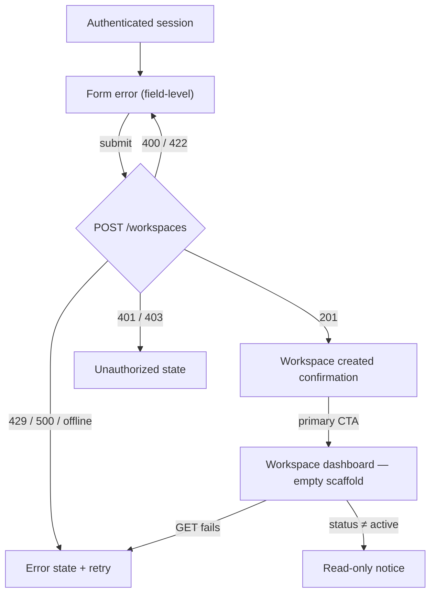

# LifeProof Portal — Design Foundation

**Status:** Draft — designer owns the next revision.
**Sources:** [`../build-plan/01_PRD.md`](../build-plan/01_PRD.md) §6–11, §15 and
[`../build-plan/02_ARCHITECTURE.md`](../build-plan/02_ARCHITECTURE.md) §7.

## 1. Design principles

1. **Trust is the interface.** Every screen should make the next step obvious and the consequences
   clear. No surprises, no hidden state, no clever ambiguity.
2. **Grief-sensitive by default.** A beneficiary may be in crisis. Use calm language, generous spacing,
   and a visible way to get human help. Never use urgency, fear, or dark patterns.
3. **Plain language.** Target grade 8 readability. Avoid crypto, legal, and insurance jargon unless it
   is explained in one sentence.
4. **Show the chain.** Users should understand: what is stored, who can see it, what condition releases
   it, what evidence is required, and what happens after release.
5. **Accessible for the hard moment.** WCAG 2.2 AA is the floor. Keyboard, screen reader, low bandwidth,
   small screens, and reduced motion are core.
6. **No crypto aesthetic.** This is a family safe, not a wallet. Trust comes from clarity and evidence,
   not from techno-futurism.

## 2. People and contexts

- **Family organiser** — practical, time-poor, wants a checklist and a sense of completion.
- **Asset holder** — wants control, privacy, and a clear preview of what their family will see.
- **Beneficiary** — may be grieving, may not know the product, needs a guided path and human support.
- **Ops / concierge** — needs queues, evidence, SLAs, dual control, and an audit trail.
- **Professional partner** (Phase 2) — needs status and consent, not document contents.

## 3. Core flows to specify

1. Guided onboarding → security explainer → consent → workspace.
2. Add a vault item → link a document → assign a beneficiary → configure a condition → seal.
3. Invite a beneficiary and a trusted contact → consent → preview.
4. Family preview: exactly what each beneficiary will see, without contents before release.
5. Emergency pack generation and PIN protection.
6. Verification case: evidence checklist, identity verification, trusted contact attestation, review.
7. Release: cooling-off, re-verification, dual approval, secure session, receipt.
8. Dispute / legal hold: pause, explain, resolve.
9. Admin: queue, evidence viewer, dual control, reason logging, emergency freeze.
10. Annual review and life-event update.

## 4. Visual system

The foundation uses an editorial, warm, low-anxiety palette. The tokens live in
[`../../packages/design-tokens/src/index.ts`](../../packages/design-tokens/src/index.ts) and are mirrored
as CSS variables in `apps/web/src/app/globals.css`.

| Role | Value | Use |
|---|---|---|
| Ink | `#182420` | primary text, dark buttons |
| Paper | `#f7f3ec` | page background |
| Cream | `#fffdf8` | cards, surfaces |
| Accent | `#1f6f5c` | trust actions, focus, links |
| Accent soft | `#dcebe4` | selected states, calm highlights |
| Highlight | `#d9a441` | attention without alarm |
| Muted | `#5f6b65` | secondary text |
| Line | `#d9d2c3` | decorative borders and dividers only |
| Line strong | `#7d857d` | control borders; ≥3:1 non-text contrast |
| Danger | `#9c3d34` | error text and icons; ≥4.5:1 |
| Danger soft | `#f4e3e0` | error surfaces |

- **Display type:** a warm serif for headings only.
- **Body type:** system sans for readability and performance.
- **Spacing:** 4/8 px rhythm; generous section spacing.
- **Radii:** soft, not playful; 8–24 px.
- **Motion:** 120–280 ms, ease-out; never use motion to convey critical state alone.
- **Focus:** 2 px accent outline with 3 px offset. Always visible.
- **Touch targets:** at least 44 × 44 px.
- **Elevation:** one soft shadow (`shadows.soft`); borders carry most structure — see §9.6 and §9.9.
- **Type scale:** concrete sizes, line-heights, and weights in §9.6; display serif for headings only.
- **Brand:** `brand.name` is an empty placeholder (D-P0-02). No public-facing copy may hardcode a brand string — interpolate `brand.name` (see §9.8).
- **Naming note:** the surface token is `colors.white` (`#fffdf8`). The legacy alias "Cream" (and the CSS/Tailwind `cream` utility in `apps/web`) is deprecated — new specs reference `white`.

## 5. Content rules

- Say what happened, what happens next, and who to contact.
- Use “you” and “your family”, not “the user”.
- Never promise “zero-knowledge”; the MVP uses KMS envelope encryption.
- Do not display document contents in notifications, email, analytics, or logs.
- Explain legal/security disclaimers in place, not in a buried footer.
- For errors: plain-language cause + next step + support path.
- For empty states: guidance and one primary action, never a blank page.

## 6. Required states

Every core screen needs: loading, empty, error, success, disabled, unauthorized, expired session,
partial data, offline/retry, and “we need more evidence” states. Release and verification screens also
need legal hold, cooling-off, and re-verification states.

## 7. Accessibility acceptance

- WCAG 2.2 AA for all core journeys.
- Keyboard-only completion of onboarding, item creation, beneficiary invitation, and release access.
- Screen-reader labels and error announcements.
- 360 px viewport support; no hover-only actions.
- Reduced-motion support; no time-limited interactions without an extension path.
- axe checks in CI; manual audit before launch.
- **Walking skeleton:** the concrete acceptance checks, axe rule list, and contrast table for the
  create-workspace / dashboard / confirmation screens are in §9.7–§9.9.

## 8. Open design decisions

- Brand/trademark direction (LifeProof is an OtterBox trademark).
- Launch jurisdiction and cultural/legal language.
- Auth provider UI boundaries and passkey onboarding.
- How much of the release ceremony is visible to the beneficiary.
- Emergency pack format and print layout.

---

## 9. Walking-skeleton contract (T-007)

This section freezes the design contract for the **create-workspace → confirmation → dashboard** walking
skeleton, so T-011 can build it without inventing fields, states, or copy. The contract is
**contract-only**: it specifies the experience; the frontend implements it.

### 9.1 Scope and API data contract (from T-006 — frozen)

Every screen below consumes **only** fields that already exist in the frozen contract
(`docs/api/openapi.yaml`, `packages/contracts/src/workspace.ts`). T-011 must not invent fields.

| Screen | Consumes | Fields used | Not available / must not invent |
|---|---|---|---|
| Create workspace | `POST /v1/workspaces` → `WorkspaceCreate` | `name` (required, 1–200), `type` (`personal`\|`family`\|`business`, default `family`), `region` (`GB`\|`NG`, default `GB`) | — |
| Create workspace (response) | `201 Workspace` | `id`, `name` (for routing + confirmation heading) | `plan_id` is `null` (billing deferred) — do not render a plan name |
| Dashboard | `GET /v1/workspaces/{workspaceId}` → `Workspace` (or reuse the `201` body) | `name` (header), `status` (if not `active`, show read-only notice) | category items — **no category API exists yet** |
| Dashboard (category cards) | **static frontend scaffold** | the 11 category labels (FR-INV-001) are a frontend constant, not API data | `GET /v1/vault/categories` lands in E04 (future) |
| Confirmation | static copy + `Workspace.name` | `name` (interpolated) | the audit record itself is **never returned by the API**; the "recorded" hint is static copy |

- **Idempotency:** `POST /workspaces` requires an `Idempotency-Key` header. The client generates a fresh
  UUID per form submission attempt and reuses it on automatic retry of the same attempt.
- **Errors:** all failures use `ErrorEnvelope { error: { code, message, details[{field, reason}], request_id } }`.
  Field-level validation surfaces `details[]`; show the `request_id` as a support reference in error states.
- **Audit:** the server emits `workspace.created` append-only; it is **not** returned to the client. The
  confirmation screen states the fact, it does not fetch the record.
- **UI copy maps to API names:** the user-facing word for a *workspace* is **"safe"**; field labels map
  `name` → "Name your safe", `type` → "Who is this for?", `region` → "Where are you based?".

### 9.2 Flow overview



There is exactly one primary next step at every point; secondary actions are optional and never required
to make progress.

### 9.3 Screen 1 — Create workspace

**Purpose.** A new user (family organiser) names their safe, chooses who it is for, and confirms the
launch jurisdiction. One screen, three fields, one primary action.

**Layout (desktop; single column at < 640 px, 360 px floor).**

```
┌──────────────────────────────────────────────────────────────────┐
│  {brand.name}                                        [Help]      │  ← persistent app header
├──────────────────────────────────────────────────────────────────┤
│                                                                  │
│  Create your safe                                      (h1)      │
│  A place for your family's important documents and               │
│  instructions. It takes about a minute.                          │
│                                                                  │
│  Name your safe  *                                               │
│  ┌────────────────────────────────────────────────────────────┐  │
│  │ e.g. The Smith family                                      │  │
│  └────────────────────────────────────────────────────────────┘  │
│  Pick a name you'll recognise.                    0/200          │
│                                                                  │
│  Who is this for?  *                 Where are you based?  *     │
│  ┌──────────────────────────────┐  ┌───────────────────────────┐ │
│  │ My family              ▾     │  │ United Kingdom ▾          │ │
│  └──────────────────────────────┘  └───────────────────────────┘ │
│                                                                  │
│  ┌────────────────────────────────────────────────────────────┐  │
│  │ 🔒  How your information is protected                      │  │
│  │  Your documents are encrypted at rest with HSM-backed      │  │
│  │  keys and protected by strict access controls. You decide  │  │
│  │  who can see them and when they are released. We never     │  │
│  │  ask you to store seed phrases or private keys.            │  │
│  └────────────────────────────────────────────────────────────┘  │
│                                                                  │
│  [ Create safe ]          (primary button; disabled until name)  │
│                                                                  │
└──────────────────────────────────────────────────────────────────┘
```

**Fields and options (concrete).**

| Field (`WorkspaceCreate`) | Label | Control | Options / behaviour |
|---|---|---|---|
| `name` | Name your safe | text field | required; 1–200 chars; live counter `n/200`; placeholder "e.g. The Smith family" |
| `type` | Who is this for? | select | `family` = "My family" (default), `personal` = "Just me". `business` is **hidden** in Phase 1 (Phase 3 scope) even though the API accepts it |
| `region` | Where are you based? | select | `GB` = "United Kingdom (England & Wales)" (default, selected); `NG` = "Nigeria — coming later" (disabled; D-P0-01 gates Nigeria behind the proven UK release loop) |

**Security note (plain-language; no "zero-knowledge" claim — MVP is KMS envelope encryption).**
> Your documents are encrypted at rest with HSM-backed keys and protected by strict access controls.
> You decide who can see them and when they are released. We never ask you to store seed phrases or
> private keys.

**Submit.** Primary button "Create safe". Disabled while `name` is empty/whitespace or while a submit is
in flight. On submit the button shows the inline progress indicator (§9.6) and the form is disabled.

**States.**

| State | Trigger | Rendering |
|---|---|---|
| Default | initial load | region `GB` preselected, type `family` preselected, `name` empty + focused |
| Disabled | `name` empty or in-flight | primary button disabled; fields `disabled` + `aria-disabled` while in-flight |
| Error (field) | `422` `details[]` or client validation | inline message under the field in `danger`; `aria-invalid="true"`; `aria-describedby` links message; empty-name → "Enter a name for your safe."; >200 → "That name is too long. Use 200 characters or fewer." |
| Error (submit) | `429`/`500`/offline | banner above the button: "We couldn't create your safe. Please try again." + "If this keeps happening, contact support." + reference `request_id`. Retry keeps the same `Idempotency-Key` only for the identical attempt |
| Unauthorized | `401`/`403` | redirect to sign-in; calm message "Your session has ended. Sign in to continue." No form fields rendered |
| Loading | in-flight | button spinner + "Creating…"; fields disabled |
| Success | `201` | navigate to confirmation (§9.5) |

### 9.4 Screen 2 — Workspace dashboard (empty-state scaffold)

**Purpose.** After creation the user lands on a visible home: a category-first scaffold with one primary
"add" action per card. No blank screen, no dead end.

**Layout (360 px = 1 column; ≥640 px = 2 columns; ≥1024 px = 3 columns).**

```
┌──────────────────────────────────────────────────────────────────┐
│  {brand.name}            The Smith family ▾            [Help]    │
├──────────────────────────────────────────────────────────────────┤
│                                                                  │
│  Welcome to your safe                                  (h1)      │
│  Add the documents and instructions your family will need.       │
│                                                                  │
│  ┌───────────────┐ ┌───────────────┐ ┌───────────────┐          │
│  │ 📄 Documents   │ │ 🛡 Insurance   │ │ 🏦 Banking    │  …       │
│  │ Wills, IDs,    │ │ Life, health, │ │ Current and   │          │
│  │ and powers of  │ │ home, travel  │ │ savings       │          │
│  │ attorney       │ │ policies      │ │ accounts      │          │
│  │                │ │               │ │               │          │
│  │   [ Add ]      │ │   [ Add ]     │ │   [ Add ]     │          │
│  └───────────────┘ └───────────────┘ └───────────────┘          │
│   (11 cards, one per category; every card has one [Add] action)  │
│                                                                  │
└──────────────────────────────────────────────────────────────────┘
```

**The 11 category cards (FR-INV-001).** Static scaffold. Label + one-line description + a single primary
"Add" action.

| # | Category | Description (card body) |
|---|---|---|
| 1 | Documents | Wills, IDs, and powers of attorney |
| 2 | Banking | Current and savings accounts |
| 3 | Insurance | Life, health, home, and travel policies |
| 4 | Property | Deeds, mortgages, and rentals |
| 5 | Investments | Stocks, funds, and holdings |
| 6 | Pension | Workplace and private pensions |
| 7 | Tax | Returns, records, and deadlines |
| 8 | Business | Company documents and access |
| 9 | Subscriptions | Services, logins, and cancellations |
| 10 | Crypto | Exchange and custody account pointers — never seed phrases or private keys |
| 11 | Custom | Anything else that matters |

- The **Crypto** card must carry no "crypto aesthetic" (no coin icons, neon, or trading metaphors); it is
  a plain category like the others.
- **Add action.** Each card's "Add" is the single primary action. In the walking skeleton it is a
  placeholder: activating it reveals a calm inline note — "Adding {category} items is available in the next
  milestone." — not an error. Real item creation is E04 (US-030/031); do not invent vault fields now.
- **Header** shows the workspace `name` from `Workspace`; if `status ≠ active`, replace the grid with a
  read-only notice: "This safe is currently read-only. Contact support for help."

**States.**

| State | Trigger | Rendering |
|---|---|---|
| Loading | `GET /workspaces/{id}` in flight | 6 skeleton cards (`aria-busy="true"`); no layout shift |
| Empty | 0 categories populated (always true in skeleton) | the 11-card scaffold above |
| Error | `GET` fails / offline | error state with "We couldn't load your safe." + Retry button + support path + `request_id` |
| Unauthorized | `401`/`403` | redirect to sign-in; "Your session has ended. Sign in to continue." |
| Read-only | `status` is `read_only`/`suspended` | read-only notice; "Add" actions disabled |

### 9.5 Screen 3 — Workspace created confirmation

**Purpose.** Confirm success without ceremony, and tell the user their action is recorded — without
alarm.

```
┌──────────────────────────────────────────────────────────────────┐
│  ✓  Your safe is ready                                          │
│                                                                  │
│  "The Smith family" has been created.                           │
│                                                                  │
│  Everything you add is encrypted and released only through a     │
│  verified process. This action is recorded in your audit log,    │
│  so you can always see what changed and when.                    │
│                                                                  │
│  [ Go to your safe ]          (primary)                          │
│  [ Add your first document ]  (secondary, optional stub)         │
└──────────────────────────────────────────────────────────────────┘
```

- **Success icon** uses `accent` (trust green) — success and primary trust actions share the same hue so
  the palette stays calm.
- **Primary CTA** "Go to your safe" → dashboard (§9.4). This is the single required next step.
- **Secondary CTA** "Add your first document" is optional and is a stub in the skeleton (same
  "next milestone" note as the card Add action).
- **Audit hint** is non-alarming and factual: *"This action is recorded in your audit log, so you can
  always see what changed and when."* It never mentions surveillance or punishment.
- **Accessibility:** the success message is announced via a polite live region (`role="status"`); focus
  moves to the heading.

### 9.6 Component specs (token usage + anatomy + states)

All values below are concrete. Token names reference `packages/design-tokens/src/index.ts`.

**Type scale.**

| Role | Size | Line-height | Weight | Family | Use |
|---|---|---|---|---|---|
| Caption / meta | 12px / 0.75rem | 16px / 1rem | 500 | body | eyebrow, counters, `request_id` |
| Helper / label | 14px / 0.875rem | 20px / 1.25rem | 500 | body | field labels, hints, card body |
| Body | 16px / 1rem | 24px / 1.5rem | 400 | body | paragraphs, input text |
| Lead | 18px / 1.125rem | 28px / 1.75rem | 400 | body | intro paragraph |
| Card / section title | 20px / 1.25rem | 28px / 1.4rem | 500 | display | card titles, section headings |
| Page title (h1) | 30px / 1.875rem | 36px / 1.2rem | 500 | display | screen h1 (≥24px, so 3:1 large-text contrast applies) |

**1. Text field.**

- Anatomy: `<label>` (14/500, `ink`) + `<input>` (16/24, `ink`, bg `white`, 1px `lineStrong`, radius `radii.md`
  (8px), padding `space.sm` × `space.md`, min-height 44px) + helper/error text (14/20) below.
- States: **default** (`lineStrong` border), **hover** (border `ink`), **focus** (2px `accent` outline, 3px
  offset; `lineStrong` border replaced), **disabled** (bg `line`, text `muted` at 60%, border `line`,
  `cursor: not-allowed` — disabled text is exempt from 1.4.3 but never invisible), **error** (border
  `danger`, helper text `danger`, `aria-invalid="true"`), **filled** (no visual change; value persists).
- Accessibility: explicit `label` via `htmlFor`/`id`; hint/error linked with `aria-describedby`; placeholder
  never substitutes for the label; error announced politely (`aria-live="polite"` or `role="alert"` on submit).
- Copy: placeholder "e.g. The Smith family"; counter "0/200".

**2. Select.**

- Anatomy: same box as text field + native `<select>` (native for keyboard/screen-reader correctness) +
  decorative chevron (`aria-hidden`).
- States: **default / hover / focus / disabled / error** identical to text field; **placeholder option** not
  used (a real default is always selected).
- Accessibility: associated `<label>`; no custom listbox (native select only); touch target ≥44px.

**3. Button.**

- Anatomy: label (16/500) + optional `aria-hidden` icon; min-height 44px; horizontal padding `space.xl`
  (32px); radius `radii.full` (pill); `transition` on background/border/color via `motion.fast`.
- **Primary:** bg `ink`, text `white`; hover bg `accent`; active bg `accent` (pressed state); focus 2px
  `accent` outline + 3px offset; disabled bg `line`, text `muted`, no pointer.
- **Secondary:** bg `white`, 1px `lineStrong` border, text `ink`; hover border+text `accent`; disabled border
  `line`, text `muted`.
- Loading state: inline 16px spinner + label swap ("Create safe" → "Creating…"), `aria-busy="true"`,
  `disabled`; reduced-motion → static "Creating…" text, no spinner.
- Contrast: primary label `white` on `ink` = 15.7:1; on hover `white` on `accent` = 5.9:1; secondary `ink`
  on `white` = 15.7:1.

**4. Card.**

- Anatomy: container (bg `white`, 1px `line` border, radius `radii.xl` (16px), optional `shadows.soft`) +
  optional `aria-hidden` icon + eyebrow (12/500 `accent`) + title (20/500 `ink`) + body (14/20 `muted`) +
  action area (primary/secondary button).
- States: **default** (border `line`), **hover** (border `lineStrong`), **focus-within** (2px `accent` outline
  when a descendant button is focused), **selected** (bg `accentSoft`, border `accent`), **disabled**
  (bg `paper`, border `line`, text `muted`).
- Note: `line` is decorative; the card's *boundary that identifies it as interactive* is the "Add" button
  label, not the border, so the card border may stay `line`. If a card ever becomes the sole click target,
  its border must be `lineStrong` (≥3:1).

**5. Empty state.**

- Anatomy: centered block (max-width 28rem), optional `aria-hidden` illustration, heading (20/500 `ink`),
  body (16/24 `muted`), one primary button, optional secondary link. No blank page, no blame.
- Copy pattern: *what this is* + *what to do next* + *one primary action*. Example (§9.4 heading/body).
- Accessibility: heading structure preserved (h1 → h2); primary action is keyboard-reachable; no
  decorative motion unless reduced-motion-safe.

**6. Progress indicator.**

- Two variants: **inline spinner** (16px, in the submit button; `role="status"` + polite live region) and
  **skeleton cards** (dashboard loading; `aria-busy` on the region, `aria-hidden` on the shimmer).
- Rules: never convey state by motion alone (always pair with text "Creating…" / "Loading…"); respect
  `prefers-reduced-motion` (replace animation with static text); indeterminate progress never blocks
  indefinitely (no time-limited interaction without an extension path).

### 9.7 Accessibility acceptance (WCAG 2.2 AA — concrete)

These are the acceptance checks for the three walking-skeleton screens. **Floor: 360 px; WCAG 2.2 AA.**

1. **Keyboard-only.** Tab order is header → form fields → submit (create); header → card "Add" buttons
   (dashboard); heading → primary CTA (confirmation). No focus traps; no `tabindex` > 0.
2. **Visible focus.** Every interactive control shows a 2px `accent` outline + 3px offset on `:focus-visible`
   (already in `globals.css`). Focus never hidden on mouse-driven focus.
3. **Labels.** Every field and button has a programmatic name: `<label htmlFor>` on inputs/selects; visible
   text on buttons. No `aria-label` on a visible-text button (avoids name mismatch).
4. **360 px viewport.** Single column; form fields and cards full-width; no horizontal scroll; text ≥16px
   body; touch targets ≥44×44px.
5. **Reduced motion.** Spinner/skeleton animations collapse to static text/placeholder under
   `prefers-reduced-motion: reduce`; no auto-advancing content; no parallax/zoom.
6. **Contrast** (computed with existing tokens — see §9.9): body text ≥4.5:1; large text (≥24px or
   ≥18.66px bold) ≥3:1; UI boundaries ≥3:1.

**axe checks that must pass in CI** (run via `@axe-core/playwright` on the three screens; tags
`wcag2a`, `wcag2aa`, `wcag21a`, `wcag21aa`, `wcag22aa`):

| axe rule | Covers |
|---|---|
| `color-contrast` | 1.4.3 text contrast |
| `label`, `label-title-only`, `select-name`, `input-button-name`, `button-name`, `form-field-multiple-labels` | 1.3.1/3.3.2 names & labels |
| `aria-errormessage`, `error-identification` | 3.3.1 error identification |
| `aria-valid-attr-value`, `aria-allowed-attr`, `aria-roles`, `aria-required-attr`, `aria-prohibited-attr`, `aria-required-children` | ARIA validity |
| `duplicate-id`, `duplicate-id-active`, `duplicate-id-aria` | 4.1.1 unique IDs |
| `focus-order-semantics`, `tabindex` | 2.4.3 focus order |
| `image-alt`, `svg-img-alt`, `image-redundant-alt` | 1.1.1 non-text (decorative = `aria-hidden`) |
| `document-title`, `html-has-lang`, `landmark-one-main`, `region`, `landmark-unique`, `page-has-heading-one` | document structure |
| `heading-order`, `empty-heading` | 1.3.1 heading hierarchy |
| `meta-viewport` | 1.4.10 no `user-scalable=no` |
| `target-size` | 2.5.8 target size (we hold 44px) |
| `scrollable-region-focusable` | 2.1.1 focusable scroll regions |

Only **violations** fail CI; **incomplete** results are logged for manual review. A manual
screen-reader + keyboard pass (NVDA or VoiceOver) is required before launch (M4 gate).

### 9.8 Brand externalization (D-P0-02)

- `packages/design-tokens/src/index.ts` now exports `brand = { name: '' }` — an **empty placeholder**.
- **Rule for all copy in this contract and in T-011:** interpolate `brand.name`. Do **not** hardcode a
  brand string (including the internal working name) in any public-facing string. The internal working name
  may appear in internal/dev-only surfaces until M5, but not in shipping copy.
- This applies to: page titles, the app header wordmark, headings, alt text, `document.title`, and any
  visible or screen-reader-facing string.

### 9.9 Token changes and sync note (T-007)

Added to `packages/design-tokens/src/index.ts` (documented in §4):

| Token | Value | Why |
|---|---|---|
| `brand.name` | `''` | externalize the brand string (D-P0-02) |
| `colors.danger` | `#9c3d34` | error text/icons — 6.1:1 on paper, 6.6:1 on white, 5.4:1 on `dangerSoft` |
| `colors.dangerSoft` | `#f4e3e0` | error surfaces — `ink` on it = 12.9:1 |
| `colors.lineStrong` | `#7d857d` | control borders — 3.4:1 on paper, 3.7:1 on white (≥3:1 non-text) |
| `shadows.soft` | `0 24px 60px -32px rgba(24,36,32,0.28)` | source of truth for the existing `shadow-soft` utility |

**Reference contrast ratios** (existing tokens, computed): `ink`/`paper` 14.5:1 · `ink`/`white` 15.7:1 ·
`muted`/`paper` 5.0:1 · `muted`/`white` 5.5:1 · `accent`/`paper` 5.4:1 · `accent`/`white` 5.9:1 ·
`accent`/`accentSoft` 4.9:1 · `danger`/`paper` 6.1:1 · `lineStrong`/`paper` 3.4:1. **Do not use**
`highlight` as body text (2.0:1 on paper — fails); it is a decorative/attention background only (`ink` on
`highlight` = 7.1:1). **Do not use** `line` as the sole boundary of a control (1.4:1 — fails 1.4.11).

**Sync note for T-011.** `apps/web/src/app/globals.css` and `apps/web/tailwind.config.ts` do **not** yet
declare `--danger`, `--danger-soft`, or `--line-strong`, and the `cream`/`shadow-soft` utilities still live
only in Tailwind config. T-011 must mirror the three new colors into `globals.css` and route
`cream → var(--white)` and `shadow-soft` to the tokens (frontend owns `apps/web/*`; this task does not edit
it).

### 9.10 Open questions (escalate — do not decide here)

1. **Category list source.** The dashboard scaffold uses a frontend constant of 11 categories. The real
   source (`GET /v1/vault/categories`, E04) does not exist yet. Confirm the 11-label list (FR-INV-001) and
   whether "Crypto" stays visible in the beachhead (UK) given the "no crypto aesthetic" principle.
2. **User-facing word for "workspace".** This contract uses **"safe"**. Confirm the term with the owner
   before T-011 bakes it into copy.
3. **"Add" placeholder behaviour.** Confirm that the skeleton's card "Add" and "Add your first document"
   show a "next milestone" note rather than being disabled or removed (disabling creates a dead end).
4. **Nigeria option.** This contract renders `NG` as a disabled "coming later" option. Confirm that is the
   intended gating UX (vs. hiding `NG` entirely).

### 9.11 Review findings against the current shell (read-only observations for T-011)

These are observations on `apps/web/src/app/page.tsx`, `globals.css`, and `tailwind.config.ts` — not
edits (frontend owns them):

1. **Hardcoded brand.** `page.tsx` hardcodes "LifeProof" in the header, heading, body, and `aria-label`,
   and `layout.tsx` in `metadata.title`. This must be replaced with `brand.name` before any public copy
   ships (D-P0-02).
2. **`cream` alias.** `tailwind.config.ts` maps `cream → var(--white)`; `globals.css` defines `--white` but
   not `--cream`. New code should use the `white` token / `bg-white`-style utility, not `cream`.
3. **Secondary button border contrast.** The shell's secondary button uses `border-line` (1.4:1). The
   contract (§9.6) requires `lineStrong` for the resting border of interactive controls.
4. **`shadow-soft` not a token.** It exists only in Tailwind config; it is now `shadows.soft` (token) and
   should be sourced from the token.
5. **Missing semantic colors.** There is no error/danger or control-border color anywhere; form error
   states are impossible to render accessibly until `danger`/`lineStrong` are mirrored.
